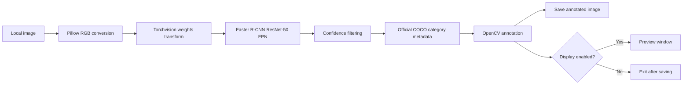

# VerityAgent AI Object Detection

**VerityAgent Python AI Mini Projects** · Computer Vision · PyTorch · Torchvision

Detect and label objects in a still image with COCO-pretrained Faster R-CNN and a ResNet-50 Feature Pyramid Network (FPN). Supports CPU or automatic CUDA selection, configurable confidence filtering, annotated image export, and optional GUI display.

> This is image-based inference, not a live CCTV/video pipeline. It does not train a model or require an API key.

## Features

- Modern Torchvision weights API: `FasterRCNN_ResNet50_FPN_Weights.DEFAULT`
- Complete category names from the weights' official `meta["categories"]` metadata
- `torch.inference_mode()` for inference
- Confidence threshold configurable from 0.0 to 1.0
- Bounding boxes, class names, and confidence scores
- Creates output directories automatically
- Headless mode via `--no-display`
- Clear errors for missing/invalid images and model-loading problems
- Unit tests do not download pretrained weights

## Pipeline



## Project structure

```text
verityagent-ai-object-detection/
├── app.py
├── config.py
├── detector.py
├── visualization.py
├── requirements.txt
├── .gitignore
├── README.md
├── assets/.gitkeep
├── output/.gitkeep
└── tests/
    ├── test_config.py
    ├── test_detector.py
    └── test_visualization.py
```

## Requirements

- Python **3.10–3.12** (Python 3.11 recommended)
- pip and virtual environment
- Internet access for the first pretrained-weight download (unless cached)
- CPU is supported; CUDA is selected when the installed PyTorch build and system support it

| Package | Pinned version | Purpose |
|---|---:|---|
| PyTorch | 2.5.1 | Tensor runtime and inference |
| Torchvision | 0.20.1 | Faster R-CNN model, weights, transforms |
| Pillow | 11.0.0 | Image loading |
| OpenCV | 4.10.0.84 | Drawing and optional display |
| NumPy | 2.1.3 | Image array conversion |
| pytest | 8.3.3 | Tests |

PyTorch 2.5.1 and Torchvision 0.20.1 are a matched release pair. For CUDA-specific setups, choose the appropriate PyTorch wheel using the official PyTorch installation selector, then install the remaining pinned dependencies without overwriting the chosen wheel.

## Installation

### Windows PowerShell

```powershell
git clone <YOUR_REPOSITORY_URL>
cd verityagent-ai-object-detection
py -3.11 -m venv .venv
.\.venv\Scripts\Activate.ps1
python -m pip install --upgrade pip
pip install -r requirements.txt
```

### macOS / Linux

```bash
git clone <YOUR_REPOSITORY_URL>
cd verityagent-ai-object-detection
python3.11 -m venv .venv
source .venv/bin/activate
python -m pip install --upgrade pip
pip install -r requirements.txt
```

Replace `<YOUR_REPOSITORY_URL>` with the clone URL shown on the repository page. If Windows blocks virtual-environment activation, use `.venv\Scripts\python.exe` directly.

## Run

Place an image you have permission to use at `assets/input.jpg`, or pass another local image path.

```bash
# Defaults: assets/input.jpg -> output/annotated.jpg; GUI preview enabled
python app.py

# Explicit input/output paths and 70% confidence threshold
python app.py --image "assets/street.jpg" --output "output/street-detections.jpg" --threshold 0.70

# Headless, remote desktop, or server use
python app.py --image "assets/street.jpg" --output "output/street-detections.jpg" --no-display

# CLI help
python app.py --help
```

Threshold must be between `0.0` and `1.0`; a prediction exactly equal to the threshold is retained. The output directory is created automatically. The first run may download several hundred megabytes of model weights, which Torchvision caches locally.

## Sample configuration

Defaults live in `config.py` and can be used from Python:

```python
from pathlib import Path
from config import DetectionConfig

config = DetectionConfig(
    image_path=Path("assets/input.jpg"),
    output_path=Path("output/annotated.jpg"),
    confidence_threshold=0.50,
    display=True,
)
```

Command-line arguments override these defaults. Large model weights and sample photographs are intentionally not committed.

## Expected output

The application logs the selected device, number of detections above threshold, each label with confidence and pixel coordinates, and the saved path. Example format only (actual results depend on the image):

```text
INFO: Device: cpu
INFO: Detections above threshold 0.50: 2
INFO:   person               confidence=0.934 box=[43, 21, 210, 402]
INFO:   backpack             confidence=0.812 box=[165, 175, 289, 330]
INFO: Annotated image saved to: output/annotated.jpg
```

Open the generated image to inspect boxes and labels. The example detections are illustrative, not guaranteed output.

## Tests

```bash
pytest -q
```

Tests cover threshold filtering (including boundary behavior), label mapping, malformed prediction output, configuration validation, annotation behavior, and saving output. Tests use synthetic tensors and generated images; they do not require model weights, internet access, a webcam, or a GPU.

## Troubleshooting

- **Missing input:** confirm the path exists and the current working directory is the repository root.
- **Unreadable image:** use a supported image file that Pillow can decode.
- **Model download fails:** check internet access and retry; the pretrained checkpoint is downloaded by Torchvision.
- **Torch/Torchvision operator errors:** install a compatible pair (the pinned pair is PyTorch 2.5.1 + Torchvision 0.20.1).
- **CUDA not selected:** run `python -c "import torch; print(torch.__version__, torch.cuda.is_available())"`; install a CUDA-enabled PyTorch build compatible with your driver if necessary. CPU remains supported.
- **GUI fails on a server/headless system:** add `--no-display`.
- **No detections:** try a lower threshold, such as `--threshold 0.25`, and verify that the image contains recognizable COCO classes.

## Limitations and responsible use

- Detects the classes included in the selected pretrained COCO model; it is not a universal detector.
- Results depend on image quality, object scale, occlusion, lighting, and domain shift.
- CPU inference can be slow, particularly on large images.
- Processes one still image per invocation; video, webcam, RTSP/CCTV, tracking, and monitoring are out of scope.
- Use images lawfully and respect privacy, consent, and applicable policies. Images are processed locally; pretrained weights may be downloaded from Torchvision's configured model host.

---

Part of the **VerityAgent Python AI Mini Projects** series.
